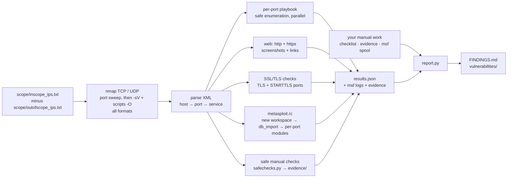

# ReconFlow

**From a list of IPs to a reproducible findings report — in one command.**

ReconFlow is a network recon orchestrator for authorized penetration tests. It
runs nmap, fans every open port out to the right enumeration tools, drives
Metasploit's auxiliary scanners from the database, screenshots every web
service, and writes a `FINDINGS.md` that tells the tester exactly how to
reproduce each finding — host by host. Manual work (your own Metasploit
sessions, hand-run checks) flows back into the same report: run
`report.py` and it rebuilds everything, without touching a target.

Anything it can't do (missing tool, timeout, unknown service, filtered host) is
never dropped silently: it is listed in the report for manual follow-up.

> [!WARNING]
> **Authorized use only.** Only scan systems you have written permission to
> test. Before anything touches a target, ReconFlow shows the scope and asks
> whether to proceed — answer N and nothing is run.

## Start here — the whole picture

| Step | What | Doc |
|---|---|---|
| **1** | Install the tools (once per machine) | [docs/workflow/TOOLS_INSTALLATION.md](docs/workflow/TOOLS_INSTALLATION.md) |
| **2** | Run the scan — `sudo python3 reconflow.py -o <folder>` | [Quick start](#quick-start) |
| **3** | *Only if you answered **N** to Metasploit:* run the modules yourself | [docs/workflow/MANUAL_METASPLOIT.md](docs/workflow/MANUAL_METASPLOIT.md) |
| **4** | **Always:** everything automation doesn't do — the safe checks already ran; review *Safe checks — possible issues* in `FINDINGS.md`, then the dangerous ones | [docs/workflow/MANDATORY_CHECKS.md](docs/workflow/MANDATORY_CHECKS.md) |
| **5** | Rebuild the report — `python3 report.py <folder>` | [Reporting](#reporting) |

Your answer to *"Also run the Metasploit modules automatically?"* picks the
path. **Either path covers everything:**

| Path | You answer | You do |
|---|---|---|
| **A** | **y** / **y** — recon + Metasploit | run ReconFlow → [MANDATORY_CHECKS.md](docs/workflow/MANDATORY_CHECKS.md) → `report.py` |
| **B** | **y** / **N** — recon only | run ReconFlow → [MANUAL_METASPLOIT.md](docs/workflow/MANUAL_METASPLOIT.md) → [MANDATORY_CHECKS.md](docs/workflow/MANDATORY_CHECKS.md) → `report.py` |

The docs in [docs/reference/](docs/reference/) are for looking things up —
never a required step. Overview: [docs/README.md](docs/README.md).

## Contents

- [Start here — the whole picture](#start-here--the-whole-picture)
- [How it works](#how-it-works)
- [What it finds](#what-it-finds)
- [Safe by default](#safe-by-default)
- [Quick start](#quick-start)
- [Usage](#usage)
- [Scope files](#scope-files)
- [Reporting](#reporting)
- [Output](#output)
- [Project layout](#project-layout)
- [Documentation](#documentation)
- [Extending](#extending)
- [Disclaimer](#disclaimer)

---

## How it works



1. **Scope** — `scope/inscope_ips.txt` minus `scope/outofscope_ips.txt`, handy for carving
   a few hosts out of a big subnet. Exclusions go to nmap as `--excludefile`
   and are filtered out again before every later step.
   See [Scope files](#scope-files) — **use IPs, not hostnames, for exclusions.**
2. **Scan** — nmap on **all 65535 TCP ports** **and the top 100 UDP ports**
   (`-sU -sV`). The TCP scan runs in two phases: a fast sweep of every port
   (`-p- -sS`), then version, script and OS detection (`-sV -O` + nmap's
   default scripts) only on the ports found open. Every format is saved
   (`.nmap` / `.xml` / `.gnmap`). `--quick` and `--no-udp` trade coverage
   for speed. Hosts that don't answer ping are skipped and counted in the
   report — use `--pn` when the targets block ping.
3. **Classify** — each open port is mapped to a service by nmap name first,
   then port number, so non-standard ports work (FTP on 2121 is still FTP).
4. **Enumerate** — a per-service playbook runs checks against the *real*
   port: nmap NSE, smbclient, enum4linux-ng, nxc, snmpwalk, ldapsearch,
   rpcinfo, redis-cli, curl, whatweb, sslscan, and more.
5. **Web** — probes **both** `http://` and `https://` on every web port,
   screenshots them (gowitness / httpx), and builds `web-report.html` with a
   link, status code and page title for every URL.
6. **SSL/TLS** — every TLS port and every STARTTLS service (SMTP, FTP, IMAP,
   POP3, LDAP, Postgres, MySQL) that offers TLS (nmap's `ssl-cert` in the
   scan shows which) is checked for old protocols, weak ciphers,
   expired / self-signed certificates, Heartbleed, POODLE, CCS injection and
   weak DH.
7. **Metasploit** — generates a DB-driven `metasploit.rc`
   (`services -p <port> -R` feeds RHOSTS from the imported scan). Every run
   gets its own new workspace (`<folder>_<date>_<time>`), so it only ever
   holds this run's hosts. It runs only if you answer **y** to the
   Metasploit question; otherwise you run it yourself.
8. **Safe manual checks** — `safechecks.py` runs the read-only checks of
   MANDATORY_CHECKS Part 1 on every target: share and directory listings,
   anonymous database access, exposed web files, TLS proof, … (details:
   [SAFE_CHECKS.md](docs/reference/SAFE_CHECKS.md)). Output goes to
   `evidence/`; skip with `--no-safe-checks`.
9. **Report** — `report.py` builds `FINDINGS.md` (severity summary, nmap
   results for every IP, per-finding reproduce commands, expected output,
   next steps, fix, and the safe-check results that may be an issue) and
   the `vulnerabilities/` folder (one file per finding with the exact
   evidence lines). It also writes `manual-checklist.md` for the checks you
   do by hand.
10. **Rebuild** — after manual work, `python3 report.py <folder>` folds your
   Metasploit sessions, checklist answers and evidence into the report. See
   [Reporting](#reporting).

The whole pipeline is deterministic: fixed tools and fixed detection rules, no
AI or human step needed between the prompt and the report.

## What it finds

**From the scan itself** (service / version match):

- Backdoored releases: vsftpd 2.3.4, ProFTPD 1.3.3c, UnrealIRCd
- Samba `usermap_script`, distccd, open bind shells
- Ruby DRb, Java RMI, JDWP
- Telnet, r-services (rexec / rlogin / rsh), Tomcat manager

**From check output:**

- FTP anonymous login · SMB null sessions, anonymous shares, signing not required
- SMTP VRFY · open X11 · DNS open recursion
- NFS exports, root filesystem (`/`) exported, writable exports
- SNMP `public` community
- Unauthenticated Redis, Docker API, Elasticsearch, CouchDB, etcd, kubelet, MQTT
- Any nmap NSE result with `State: VULNERABLE`
- Deprecated TLS protocols, weak ciphers, expired / self-signed certificates

**Listed for you to run** (never run automatically — see
[Safe by default](#safe-by-default)): MySQL empty passwords, SMTP open relay,
SMTP user enumeration, open HTTP proxies, Java RMI remote class loading,
credential testing on every login service found, and exploit confirmations —
all in [MANDATORY_CHECKS.md](docs/workflow/MANDATORY_CHECKS.md).

**60+ services have a playbook** — FTP, SSH, Telnet, SMTP, DNS, POP3/IMAP,
RPC/NFS, MSRPC, SMB, SNMP, LDAP, Kerberos, RDP, MSSQL, MySQL, Postgres, Oracle,
VNC, WinRM, Redis, MongoDB, Elasticsearch, Memcached, Docker, Kubernetes, etcd,
IPMI, rsync, Java RMI, SIP, X11, IRC, AJP, MQTT, AMQP, CouchDB, Cassandra,
iSCSI, VMware, NTP, NetBIOS, IKE, TFTP, finger, printers, web.

## Safe by default

- **No brute force.** Login modules are written into `metasploit.rc`
  *commented out*; `FINDINGS.md` lists every login service that was **not**
  tested. Ready-to-paste blocks: [MANDATORY_CHECKS.md → Credential testing](docs/workflow/MANDATORY_CHECKS.md#4-credential-testing).
- **No exploitation.** Exploit modules for known-bad versions are only
  *referenced* in the report; ReconFlow never runs them.
- **Degrades gracefully.** A missing tool skips that step and lists the exact
  commands it couldn't run. Nothing crashes on a missing dependency.
- **Runs without root** (connect scan, no OS/UDP) and says what it skipped.
- **Ctrl-C stops everything.** Queued checks are dropped and every running
  tool is killed — no traffic keeps going after you interrupt.
- **Output from the target is never trusted.** Values taken from tool output
  (e.g. SMB share names) are shell-quoted before they go into a command you
  might paste.
- **Risky checks never run automatically.** Checks that act on the target
  are listed per host — in `manual-checklist.md` (section 1, ready to paste),
  `FINDINGS.md` → *Manual follow-up* and `service-checks/commands.sh` — for
  you to run deliberately:

  | Check | Why it's manual |
  |---|---|
  | `mysql-empty-password` (nmap) | tries to log in to MySQL as `root` / `anonymous` with a blank password |
  | `smtp-open-relay` (nmap) | asks the mail server to relay mail for an outside domain |
  | `smtp-enum-users` (nmap) | guesses usernames on the mail server from a wordlist |
  | `http-open-proxy` (nmap) | makes the target fetch an outside website through itself |
  | `rmi-vuln-classloader` (nmap) | asks the Java RMI registry to load a class from a remote URL |

  `http-open-proxy` is one of nmap's *default* scripts, so the scan runs
  nmap's default set with it taken out (`--script "default and not
  http-open-proxy"`) rather than plain `-sC`.

  They're collected, with credential testing and exploit confirmations, in
  [MANDATORY_CHECKS.md](docs/workflow/MANDATORY_CHECKS.md).
- **Safe checks do log in anonymously.** Recon still includes these — they
  only list what is visible, but they leave entries in the target's logs and
  may trip an IDS, so tell the client's SOC before the test:

  | Check | What it does on the target |
  |---|---|
  | `ftp-anon`, `smbclient -N`, `nxc … -u '' -p ''`, `enum4linux-ng` | log in anonymously / with a null session and list what is visible |
  | `nfs-ls`, `nfs-showmount` (nmap) | mount NFS exports read-only to list them |
  | safe checks: `smb-browse`, `ldap-dump`, `rsync-list`, `cql-anon`, `mongo-anon`, `tftp-get`, `nfs-mount` (root) | list share / module contents, read up to 50 directory entries, connect anonymously to databases, try 4 common TFTP file names, mount NFS exports read-only |

  If a target must not be touched at all, add it to
  `scope/outofscope_ips.txt`.

## Quick start

```bash
git clone https://github.com/<your-github-user>/ReconFlow.git
cd ReconFlow

# Step 1 — tools: see docs/workflow/TOOLS_INSTALLATION.md, then once:
sudo msfdb init

# Step 2 — add your targets (nano creates the file if it doesn't exist) and run
nano scope/inscope_ips.txt          # what you may test, one per line
nano scope/outofscope_ips.txt       # hosts to carve out (optional)
sudo python3 reconflow.py -o recon-clientA

# Step 3 — only if you answered N to Metasploit: docs/workflow/MANUAL_METASPLOIT.md
# Step 4 — always: docs/workflow/MANDATORY_CHECKS.md (the safe checks already ran:
#          review FINDINGS.md → "Safe checks — possible issues")

# Step 5 — fold your manual results into the report (never touches a target)
python3 report.py recon-clientA
```

See [scope/ips.example.md](scope/ips.example.md) for what you can put in the
files. If you run ReconFlow before creating them, it creates both from a
template and stops; it never scans until `scope/inscope_ips.txt` has at least
one target.

Open `recon-clientA/FINDINGS.md` — or browse `recon-clientA/vulnerabilities/`
— when it finishes. The output folder is required and is created if it
doesn't exist.

### The two questions

Before anything touches a target, ReconFlow shows the scope and asks two
questions — both up front, so the run is unattended afterwards:

```text
  AUTHORIZED USE ONLY. Scan only systems you have written permission to test.
  In scope (scope/inscope_ips.txt): 2 entries
   192.168.217.151, 192.168.217.152
  Out of scope (none): 0 entries — never touched

  Recon runs the scan and the safe per-port checks. Risky checks, credential
  testing and exploits never run — they're listed in FINDINGS.md and
  docs/workflow/MANDATORY_CHECKS.md for you to decide on.
  Proceed with recon? [y/N]
  Also run the Metasploit modules automatically? [y/N]
```

| Question | **y** | **N** (default) |
|---|---|---|
| Proceed with recon? | scan, safe per-port checks, screenshots, the report | nothing is run, no output folder is created |
| Also run the Metasploit modules? | `metasploit.rc` runs at the end; results go into the report | `metasploit.rc` is written but not run — run it yourself, or module by module with [MANUAL_METASPLOIT.md](docs/workflow/MANUAL_METASPLOIT.md), then `report.py` |

> [!IMPORTANT]
> **Whichever you choose, finish with [MANDATORY_CHECKS.md](docs/workflow/MANDATORY_CHECKS.md)**
> — everything automation doesn't do. Together they cover it all:
>
> - **y / y:** automation (with Metasploit) → MANDATORY_CHECKS.md
> - **y / N:** automation (recon only) → [MANUAL_METASPLOIT.md](docs/workflow/MANUAL_METASPLOIT.md) → MANDATORY_CHECKS.md
>
> The safe, read-only checks (browsing shares, anonymous DB access, exposed
> web files, …) already ran with the scan: MANDATORY_CHECKS.md starts with
> reviewing their *possible issues* in `FINDINGS.md`. Then the
> dangerous ones automation never runs — risky checks, credential testing,
> exploits, intrusive steps. Run each dangerous one only if it's in scope, or
> mark it *not tested*.

For scripted runs, `-y` answers **y** to recon without asking, and `--msf`
answers **y** to Metasploit (without it, Metasploit doesn't run). With no
terminal to answer and no `-y`, nothing runs.

**Requirements:** Python 3.8+ and nmap. Everything else is optional and
auto-detected — see [docs/workflow/TOOLS_INSTALLATION.md](docs/workflow/TOOLS_INSTALLATION.md) for the
Kali / Ubuntu install.

## Usage

```bash
sudo python3 reconflow.py -o clientA                              # all TCP ports + top 100 UDP (default)
sudo python3 reconflow.py -o clientA --top-udp 1000               # more UDP ports (slower)
sudo python3 reconflow.py -o clientA --quick --no-udp             # fast: top 1000 TCP, no UDP
sudo python3 reconflow.py -o lab 10.0.0.0/24 192.168.1.5          # targets on the command line
python3 reconflow.py -o rerun --from-xml clientA/scan-tcp.xml     # re-process an old scan
sudo python3 reconflow.py -o clientA -y --msf                     # unattended: recon + Metasploit
sudo python3 reconflow.py -o clientA --pn                         # hosts block ping: scan every address
```

| Flag | Purpose |
|---|---|
| `-o DIR` | **required** — output folder for this run; created if it doesn't exist |
| `-iL FILE` | in-scope targets (default `scope/inscope_ips.txt`) |
| `-x FILE` | out-of-scope targets (default `scope/outofscope_ips.txt`, if present) — never scanned or tested |
| `--top-udp N` | number of top UDP ports to scan (default 100) |
| `--quick` | scan only the top 1000 TCP ports instead of all 65535 (noted in *Manual follow-up*) |
| `--no-udp` | skip the UDP scan (noted in *Manual follow-up*) |
| `--pn` | skip host discovery (nmap `-Pn`): scan every address, even ones that don't answer ping. Slower on sparse ranges |
| `--timing T4` | nmap timing template |
| `--extra "..."` | extra nmap arguments for the TCP **and** UDP scans; a port spec here overrides the default ports / `--top-udp` (use `-p T:…,U:…` to set each) |
| `--threads N` | parallel checks (default 8) |
| `--check-timeout S` | seconds per check (default 300) |
| `--no-screens`, `--no-checks` | skip screenshots / per-port checks |
| `--no-safe-checks` | skip the safe manual checks (`safechecks.py`) that run after the per-port checks |
| `--domain NAME` | safe checks: also try a DNS zone transfer for that domain (repeat for several) |
| `--with-data`, `--testssl` | safe checks: also read sample CouchDB / Elasticsearch documents (real data) / run a full testssl.sh audit (slow) |
| `--msf` | run the Metasploit modules without asking |
| `--from-xml FILE...` | skip scanning, parse existing nmap XML. Hosts outside the in-scope list (`-iL`, the targets on the command line, or `scope/inscope_ips.txt` if it has entries) and out-of-scope hosts are ignored |
| `-y` | answer **y** to *Proceed with recon?* without asking (for scripted runs); Metasploit runs only with `--msf` |

## Scope files

| File | Purpose |
|---|---|
| `scope/inscope_ips.txt` | What you are allowed to test. IPs, CIDRs, ranges (`10.0.0.1-50`, `10.0.1-3.*`) and hostnames all work. |
| `scope/outofscope_ips.txt` | Hosts carved out of the in-scope list — never scanned, checked, screenshotted or sent to Metasploit. Optional. |

Both take one target per line, with `#` comments. See
[scope/ips.example.md](scope/ips.example.md) for the syntax and a worked
example. The default paths are
found relative to `reconflow.py`, so it works from any directory. Each run saves the exact lists it used as
`scope-inscope.txt` / `scope-excluded.txt` in its output folder.

> [!IMPORTANT]
> **In `scope/outofscope_ips.txt`, list IP addresses (or CIDRs / ranges), not
> hostnames.** A hostname can slip through two ways:
>
> 1. nmap excludes only the *first* address a hostname resolves to — if
>    `db01.corp` has several IPs, the others can still be scanned when they
>    sit inside an in-scope subnet.
> 2. ReconFlow's second filter can only recognise a hostname if nmap's
>    reverse-DNS lookup reports the same name for that IP, which often it
>    doesn't.
>
> An IP means exactly one machine, so it can't be missed. Hostnames are fine
> in `inscope_ips.txt`. ReconFlow prints a warning if it finds a hostname in
> the out-of-scope file.

## Reporting

One report, built from every way you tested — automated or by hand.

```bash
python3 report.py recon-clientA
```

`report.py` **never contacts a target**. It reads what is in the output folder
and rebuilds `FINDINGS.md` and `vulnerabilities/` from scratch — run it as
often as you like; the same files always give the same report.
`reconflow.py` uses the same code for the first report at the end of a run.

**Before any manual work, go to the output folder:**

```bash
cd recon-clientA        # the folder you passed to -o
```

The checklist commands save to `evidence/` and Metasploit reads `targets/`
from there. Run from anywhere else and your results miss the report. Run
`report.py` from the parent folder afterwards, or as
`python3 ../report.py .` from inside it.

**What it reads** — each way of testing records into its own file:

| Way of testing | Recorded in | Who writes it |
|---|---|---|
| Recon | `results.json` (+ scan XML, `service-checks/`) | `reconflow.py` |
| Safe manual checks | `evidence/<check>_<ip>_<port>_1.txt` (+ index `SAFE-CHECKS.md`) | `reconflow.py` (via `safechecks.py`) — clear problems become findings; the rest is listed as *possible issues* with a command to reproduce |
| Metasploit, automatic | `msf-run.log` | the automatic run (`spool` in `metasploit.rc`) |
| Metasploit, by hand | `msf-manual.log` (any `msf-manual*.log`) | **you** — start with `msfconsole -r <folder>/msf-manual.rc` (spools it for you) |
| Risky checks + verifying findings | `manual-checklist.md` + `evidence/` | `reconflow.py` creates it; **you** run its commands and tick results |
| Checks from MANDATORY_CHECKS run on every target (`tools/rf-helpers.sh`) | `evidence/<name>_<ip>_<port>_<n>.txt` | **you** — read automatically and judged by the same rules as recon |
| Credential tests / other Metasploit blocks from MANDATORY_CHECKS | `msf-manual.log` | **you** — a successful login becomes the finding *Weak / default credentials accepted* |
| Everything no rule recognises (a zone transfer, a sensitive share, …) | `manual-checklist.md` → *3. New findings* (+ the file in `evidence/`) | **you** |

**When it rebuilds:**

| You do | Report rebuilt? |
|---|---|
| Run `reconflow.py` | yes, automatically at the end |
| Run `safechecks.py` on its own (re-running safe checks later) | yes, automatically at the end |
| Run Metasploit by hand / work through the checklist | not yet — your files just record it |
| Run `python3 report.py <folder>` | **yes** — everything so far, from all sources |

### The manual checklist

> [!IMPORTANT]
> **Before any manual work:**
>
> 1. **`cd` into the output folder first.** Checklist commands save to
>    `evidence/…` relative to your shell, so from anywhere else the files
>    land in the wrong place and `report.py` won't find them. The exact `cd`
>    line is at the top of `manual-checklist.md`.
> 2. **Start msfconsole with `msf-manual.rc`** —
>    `msfconsole -r /full/path/to/<folder>/msf-manual.rc`. It spools the
>    session to `<folder>/msf-manual.log` with the full path (a bare
>    `spool msf-manual.log` would save wherever msfconsole was started),
>    imports the scan and leaves you at the prompt. See
>    [MANUAL_METASPLOIT.md](docs/workflow/MANUAL_METASPLOIT.md).
>
> Got it wrong anyway? `report.py` looks for checklist evidence and
> `msf-manual*.log` in your current, parent and home folders, and prints the
> `mv` to move them in — in the terminal and in `FINDINGS.md` → *Manual
> follow-up*. It never moves anything itself.

`manual-checklist.md` has one entry per finding and per risky check, with the
commands already filled in for your hosts. Each command saves its output to
`evidence/` (`| tee`, or `script` for interactive sessions like `nc`):

````markdown
### F-03 · Critical · MySQL account with empty password — 192.168.217.151:3306/tcp

```bash
nmap -Pn -p3306 --script mysql-empty-password 192.168.217.151 2>&1 | tee evidence/R_mysql-empty_192.168.217.151_3306_1.txt
```

- Result: [ ] confirmed  [ ] false positive  [ ] not tested
- Severity override:
- Notes:
````

`report.py` checks the evidence files with **the same detection rules** as
recon — when the output shows the issue, the finding becomes **Confirmed**
automatically. Tick a box only for **false positive**, **not tested**, or
something the output can't show. Your answers are never changed; findings
from later runs are added at the end of the file.

### Status and "Detected by"

Every finding — and every affected host — gets:

| Status | Meaning |
|---|---|
| **Confirmed** | shown by your evidence, your own Metasploit session, or ticked *confirmed* |
| **Detected** | found by automation (recon / automatic Metasploit), not yet verified by hand |
| **Not reproduced** | you attached evidence, but it doesn't show the issue — check it |
| **Not tested** | ticked *not tested* (e.g. out of scope) |
| **False positive** | ticked *false positive* — moved to an appendix and `vulnerabilities/false-positives/` |

**Detected by** lists every source that saw it: *Recon*, *Metasploit (auto)*,
*Metasploit (manual)*, *Manual* — so you can compare paths at a glance. A
finding you confirmed that a later scan no longer sees stays in the report,
marked *not seen in latest scan*. Finding IDs (`F-07`) never change between
rebuilds (`report-ids.json`); your own findings get `M-01`, `M-02`, …

### The vulnerabilities folder

```text
vulnerabilities/
├── INDEX.md                 every finding: severity, hosts, detected by, status
├── critical/  high/  medium/  low/  info/
│   └── f-06-vsftpd-2-3-4-backdoored-release-….md
├── false-positives/
├── by-host/
│   └── 192.168.217.151.md   everything on one host (+ unmatched Metasploit output)
└── hosts/
    └── vsftpd-234.txt       each finding's ip:port list — target exactly those hosts
```

Each file quotes the **exact lines** that triggered the finding — from the
check output, the Metasploit log and your evidence — with links to the full
files, then how to reproduce and fix it.

> [!NOTE]
> `FINDINGS.md` and `vulnerabilities/` are fully generated. Anything typed
> into them is lost on the next rebuild — record results in
> `manual-checklist.md` instead.

## Output

Everything a run produces goes into the folder given with `-o`. If the folder
doesn't exist it is created, with its own `.gitignore` so client results are
never committed, wherever the folder lives.

**Re-running into the same folder** (e.g. after a scope change) replaces the
earlier run's generated output — scans, `service-checks/`, `open-ports/`,
`targets/`, `needs-attention/`, screenshots, the rc files — so nothing stale
looks like a current result. Your own work is kept: `manual-checklist.md`,
`evidence/`, `msf-manual*.log` and `report-ids.json`. An earlier
`msf-run.log` is renamed `msf-run-previous-<date>.log` when Metasploit
doesn't run this time (with `--from-xml`, scan files are never removed).
The new run also gets a new msf workspace, so hosts from the earlier run
can't be targeted. Old workspaces stay in the msf database — list them with
`workspace`, remove one with `workspace -d <name>`.

```text
<output folder>/                   the -o folder
├── FINDINGS.md                    ← start here: the report (generated)
├── vulnerabilities/               one file per finding, by severity + by host (generated)
├── manual-checklist.md            commands for hand-run checks — your answers go here
├── evidence/                      output saved by the checklist commands and tools/rf-helpers.sh
├── msf-blocks/                    msf blocks written by msf_rc (MANDATORY_CHECKS), run with `resource`
├── SAFE-CHECKS.md                 written by safechecks.py: every file it saved, possible hits, what to look for
├── results.json                   recon results, read by report.py
├── report-ids.json                keeps finding IDs stable between rebuilds
├── scope-inscope.txt              exact in-scope list used for this run
├── scope-excluded.txt             exact out-of-scope list used for this run
├── scan-tcp-ports.nmap / .xml / .gnmap  TCP port sweep, phase 1 (full scan only)
├── scan-tcp-hosts.txt             hosts with an open port, input to phase 2
├── scan-tcp.nmap / .xml / .gnmap  TCP detection scan (phase 2), all formats
├── scan-udp.nmap / .xml / .gnmap  UDP scan (needs root; not with --no-udp)
├── web-report.html                every URL probed: link, status, title, screenshot
├── web-screenshots/
├── service-checks/                per-port check output + commands.sh (re-runnable)
├── open-ports/                    ftp-open.txt, smb-open.txt, … all-open.txt
├── targets/                       per-port IP lists for `set RHOSTS file:...`
├── needs-attention/               services with no automated coverage
├── metasploit.rc                  new workspace + db_import + per-port modules
├── msf-manual.rc                  start your own msfconsole session (spooled)
├── msf-run.log                    automatic Metasploit run (replaced each run)
├── msf-run-previous-<date>.log    an earlier run's log, kept when Metasploit didn't run this time
├── msf-findings.txt               every [+] line from msf-run.log
└── msf-manual.log                 your own msfconsole session (msf-manual.rc spools it)
```

Each finding in `FINDINGS.md` looks like this:

````markdown
### F-16 · Medium · FTP anonymous login allowed

**Status:** Confirmed · **Detected by:** Recon, Metasploit (auto), Manual · **Details & evidence:** `vulnerabilities/medium/f-16-ftp-anonymous-login-allowed.md`

**Why it matters:** Anyone can read (and possibly write) files on the server.

**Affected (1):**
- `10.0.0.5:21/tcp` — **Confirmed** (Recon, Metasploit (auto), Manual)

**Reproduce:**
```bash
# 10.0.0.5:21
nmap -Pn -p21 --script ftp-anon 10.0.0.5
ftp -P 21 10.0.0.5     # user: anonymous  pass: anything → ls -la
```

**Expected:** `Anonymous FTP login allowed (FTP code 230)`.

**Next steps:** List what is readable; check write access with a harmless test file.

**Fix:** Disable anonymous FTP (vsftpd: anonymous_enable=NO).
````

## Project layout

```text
ReconFlow/
├── reconflow.py              the tool — scans and tests (run this first)
├── report.py                 rebuilds the report; never touches a target
├── safechecks.py             the safe manual checks — run by reconflow.py; on its own to re-run them
├── README.md                 this file
├── .gitignore
├── scope/                    engagement scope (your targets)
│   ├── inscope_ips.txt       what you may test            (git-ignored)
│   ├── outofscope_ips.txt    hosts to carve out           (git-ignored)
│   └── ips.example.md        syntax reference + example
├── tools/
│   └── rf-helpers.sh         each / each_file / msf_rc: run MANDATORY_CHECKS on every target
├── tests/
│   └── test_rules.py         rule tests: saved tool output → expected findings
├── docs/                     guides (static, not regenerated per run)
│   ├── README.md             start here: the whole picture
│   ├── workflow/             follow these, in order
│   │   ├── TOOLS_INSTALLATION.md
│   │   ├── MANUAL_METASPLOIT.md   (only if you skipped automatic Metasploit)
│   │   └── MANDATORY_CHECKS.md
│   └── reference/            look things up — never a step
│       ├── AUTOMATED_TESTING.md
│       ├── SAFE_CHECKS.md
│       └── MANUAL_VERIFICATION.md
└── <output folders>/         one per run, named with -o   (git-ignored)
```

## Documentation

Start with [docs/README.md](docs/README.md) — the whole picture.

**`docs/workflow/` — follow these, in order:**

| Step | File | What it's for |
|---|---|---|
| 1 | [TOOLS_INSTALLATION.md](docs/workflow/TOOLS_INSTALLATION.md) | Kali / Ubuntu install, msf database setup, verification |
| 3 | [MANUAL_METASPLOIT.md](docs/workflow/MANUAL_METASPLOIT.md) | only if you answered **N** to Metasploit — the same modules, by hand |
| 4 | [MANDATORY_CHECKS.md](docs/workflow/MANDATORY_CHECKS.md) | **after every run** — review the safe checks' possible issues, then the dangerous checks automation never runs |

**`docs/reference/` — look things up, never a step:**

| File | Open it when you want to know |
|---|---|
| [AUTOMATED_TESTING.md](docs/reference/AUTOMATED_TESTING.md) | exactly what automation runs: per-port checks and modules, `metasploit.rc` layout |
| [SAFE_CHECKS.md](docs/reference/SAFE_CHECKS.md) | what each `safechecks.py` check does, its options, and how to re-run one by hand |
| [MANUAL_VERIFICATION.md](docs/reference/MANUAL_VERIFICATION.md) | how to check a service or finding by hand, and rule out false positives |

## Extending

Everything service-specific lives in data tables at the top of
`reconflow.py`:

| Table | What it controls |
|---|---|
| `PORT_BUCKET` / `NAME_BUCKET` | map ports and nmap service names to a service |
| `PLAYBOOK` | per service: `checks` (commands), `msf` (modules), `login` (credential module — written commented out, never run), `manual` (hints; each must have an entry in MANDATORY_CHECKS.md) |
| `PLAYBOOK` → `risky` | checks that act on the target — never run; listed in the checklist. An entry may carry its own finding id as a third element |
| `FINDING_INFO` | each finding's severity, reproduce steps, expected output and fix |
| `VERSION_RULES` / `OUTPUT_RULES` | the regexes that decide when a finding applies (scan + check output) |
| `MSF_RULES` | which Metasploit result line means which finding |
| `EVIDENCE_RULES` | extra rules for hand-run output (`uid=…` from a shell, `230` from FTP, …) |

`report.py` holds no rules of its own — it uses these, so a new rule applies
to recon, Metasploit logs and your evidence alike.

Add a service by adding one `PLAYBOOK` entry; add a finding by adding one
`FINDING_INFO` entry and the regex that detects it.

**Add a sample to `tests/test_rules.py` with every new or changed rule** —
a few lines of the real tool's output and the finding it should give. The
tests use the standard library only and never touch the network:

```bash
python3 -m unittest discover -s tests -v
```

They also fail if a rule in `OUTPUT_RULES` / `VERSION_RULES` has no sample,
or if a risky script ever ends up in an automated check.

## Disclaimer

ReconFlow is intended for security professionals testing systems they are
authorized to assess. You are responsible for staying within your scope and
for complying with applicable laws. The authors accept no liability for misuse.
