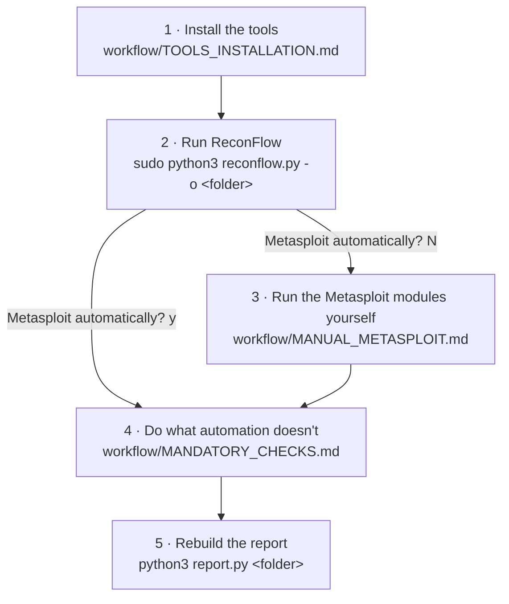

# ReconFlow docs — start here

> [!WARNING]
> **Authorized engagements only.**

## The picture

| Step | What | Doc |
|---|---|---|
| **1** | Install the tools (once per machine) | [workflow/TOOLS_INSTALLATION.md](workflow/TOOLS_INSTALLATION.md) |
| **2** | Run the scan: `sudo python3 reconflow.py -o <folder>` and answer the two questions | [README → Quick start](../README.md#quick-start) |
| **3** | *Only if you answered **N** to Metasploit:* run the same modules by hand | [workflow/MANUAL_METASPLOIT.md](workflow/MANUAL_METASPLOIT.md) |
| **4** | **Always:** everything automation doesn't do — review the safe checks' possible issues (they ran with the scan), then the dangerous ones (run only if in scope) | [workflow/MANDATORY_CHECKS.md](workflow/MANDATORY_CHECKS.md) |
| **5** | Rebuild the report with your results: `python3 report.py <folder>` | [README → Reporting](../README.md#reporting) |

Your answer to *"Also run the Metasploit modules automatically?"* picks the
path. **Either path covers everything** — nothing else is required:

| Path | You answer | You do |
|---|---|---|
| **A** | **y** / **y** — recon + Metasploit | steps 1 → 2 → **4** → 5 |
| **B** | **y** / **N** — recon only | steps 1 → 2 → **3** → **4** → 5 |

## `workflow/` — follow these, in order

| Doc | Use it to |
|---|---|
| [TOOLS_INSTALLATION.md](workflow/TOOLS_INSTALLATION.md) | install nmap, Metasploit and the other tools; set up the msf database |
| [MANUAL_METASPLOIT.md](workflow/MANUAL_METASPLOIT.md) | run the automatic Metasploit modules yourself, block by block |
| [MANDATORY_CHECKS.md](workflow/MANDATORY_CHECKS.md) | finish every run: the safe checks' possible issues, what still needs a person, and the dangerous checks automation never runs |

## `reference/` — look things up, never a step

| Doc | Open it when you want to know |
|---|---|
| [AUTOMATED_TESTING.md](reference/AUTOMATED_TESTING.md) | exactly what automation runs: per-port checks and modules, the `metasploit.rc` layout, what comes back to you |
| [SAFE_CHECKS.md](reference/SAFE_CHECKS.md) | what each `safechecks.py` check does, its options, and how to re-run one by hand |
| [MANUAL_VERIFICATION.md](reference/MANUAL_VERIFICATION.md) | how to check a service or finding by hand, and rule out false positives (`FINDINGS.md` already has the reproduce commands for your hosts) |
